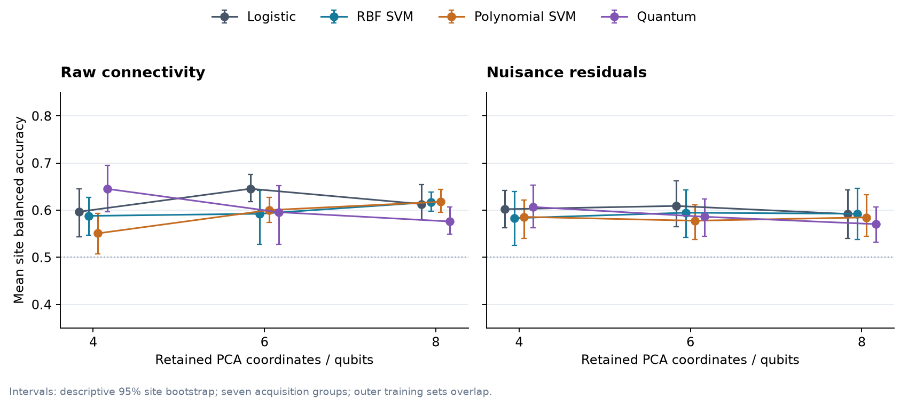
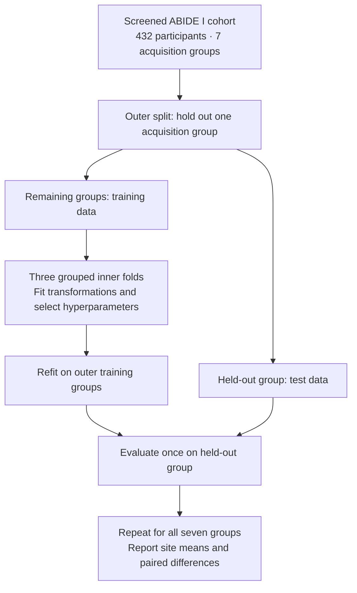
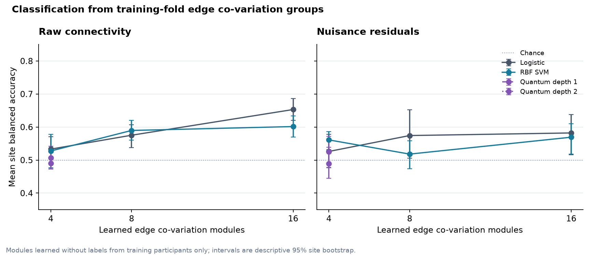

# Quantum Neuro ML

**A cross-site benchmark of classical and quantum machine learning for functional brain connectivity.**

[Results report](docs/overnight-results.md) · [Study protocol](docs/research-protocol.md) · [Reproduction guide](docs/reproduction.md) · [Data card](docs/data-card.md) · [Artifact audit](docs/results/artifact-audit.json)

Do quantum feature maps or trainable quantum readouts improve classification when the test data come from an unseen acquisition group? This study compares them with classical models on the same folds and representations, using a screened ABIDE I resting-state fMRI cohort.

The completed benchmark covers **432 participants, seven acquisition groups and 17 experiment series**. Its independent artifact audit checks 161 model settings and 69,552 held-out prediction rows, plus the permutation artifacts. Public outputs contain aggregate results; participant-level data and predictions remain outside Git.



*Points show unweighted means across seven held-out acquisition groups for the primary PCA seed, 42. Error bars are descriptive 95% site-bootstrap intervals; outer training sets overlap. The three-seed analysis is reported below and in the full results.*

## What the experiments show

A four-coordinate quantum fidelity kernel reached **64.6% mean site balanced accuracy** across three PCA seeds, above its matched compressed logistic and RBF models. The full-connectivity logistic reference remained stronger at **69.1%**. The quantum result weakened after nuisance residualization and with less training data; it did not extend to the trainable quantum readouts.

| Comparison | Mean site balanced accuracy | Context |
|---|---:|---|
| Full-edge logistic reference | 69.1% | Uses the complete connectivity representation |
| Raw PCA4 quantum kernel | 64.6% | Mean over three PCA seeds |
| Matched raw PCA4 logistic | 59.6% | Same compressed inputs and folds |
| Matched raw PCA4 RBF SVM | 58.9% | Same compressed inputs and folds |
| Raw PCA4 trainable quantum readout | 56.5% | Below its matched 19-parameter MLP at 58.8% |
| Raw edge co-variation, 16 groups, logistic | 65.3% | Exploratory representation follow-up |

These comparisons do not establish quantum advantage or clinical utility. They span seven acquisition groups and several exploratory settings. The [results report](docs/overnight-results.md) gives the paired differences, uncertainty, nuisance controls and weaker results. The [sanitized aggregate](docs/results/aggregate.json) contains fold-level metrics and model settings.

## How evaluation avoids leakage

The outer loop holds out an entire acquisition group. Every fitted transformation, including scaling, residualization, PCA, graph encoding and edge grouping, uses only the relevant training partition. Three grouped inner folds select hyperparameters before the final fit for that outer fold.



The cohort uses the ABIDE I PCP C-PAC filtered, no-global-signal-regression, CC200 derivatives. The frozen policy requires complete demographic and motion fields, five manual quality ratings marked OK, mean framewise displacement below 0.2, at least 100 timepoints, and minimum group sizes. Two constant-signal scans were excluded after metadata screening. See the [cohort policy](docs/cohort-policy.md) and [cohort audit](docs/cohort-audit.md).

## The higher-order representation experiment

The edge co-variation follow-up groups connectivity edges by how their strengths vary together across training participants. It selects high-variance edges, clusters them by absolute correlation, and forms signed group summaries without using diagnosis labels to learn the groups.



The best setting was the 16-group raw logistic model at 65.3%. The four-group quantum kernels were near chance. Signed group overlap across outer folds averaged only 30–42%, which limits biological interpretation: these are cohort-dependent statistical groupings. The [protocol](docs/covariation-protocol.md) and [stability summary](docs/results/covariation-stability.json) retain the full comparison.

## Run and reproduce

Use Python 3.11 and [uv](https://docs.astral.sh/uv/getting-started/installation/). The lockfile records dependency versions. The complete test suite includes the graph and quantum extras:

```bash
git clone https://github.com/MostafaAbdelmegeed/quantum-neuro-ml.git
cd quantum-neuro-ml
uv sync --locked --extra dev --extra graph --extra quantum --python 3.11
uv run --locked --extra dev --extra graph --extra quantum python -m pytest
```

To generate the manifest and screened connectivity dataset, then run the classical reference:

```bash
uv run --locked qneuro-abide-manifest --output data/manifests/abide-cpac-filt-noglobal-cc200.csv
uv run --locked qneuro-abide-cohort
uv run --locked qneuro-abide-build --workers 4
uv run --locked qneuro-abide-baseline
```

Data acquisition requires network access. Read the [data-use and citation notes](docs/data-use.md) before downloading. The code license does not cover the dataset. For the frozen snapshot, offline reproduction, quantum comparisons, independent artifact audit and figure generation, follow the [reproduction guide](docs/reproduction.md) and [classical baseline instructions](docs/classical-baselines.md).

The original classical reference was independently rerun: all 1,296 prediction rows and model summaries matched, and its prediction file was byte-identical. The broader artifact audit recomputes metrics and checks partitions, participant identities and source receipts. It does not refit every model or the 99 permutation classifiers.

## Repository map

| Location | Contents |
|---|---|
| [`src/quantum_neuro_ml/`](src/quantum_neuro_ml/) | Data pipeline, representations, classical models and quantum comparisons |
| [`config/`](config/) | Frozen cohort and experiment configurations |
| [`scripts/`](scripts/) | Follow-up experiments, audits and public figure generation |
| [`tests/`](tests/) | Data, fold isolation, numerical and artifact checks |
| [`docs/`](docs/README.md) | Protocols, methods, results and research decisions |
| [`docs/results/`](docs/results/) | Sanitized aggregate, independent audit and group-stability summary |
| [`docs/figures/`](docs/figures/) | Publication figures in PNG and SVG |

`data/`, `results/` and `artifacts/` are ignored local directories. Downloaded scans, participant metadata and individual predictions are not distributed with this repository.

## Current status and companion project

The primary benchmark and bounded follow-ups are complete. External validation remains unresolved: an ABIDE II metadata inventory found 1,007 candidates across 16 readable collection tables, but the available tables lack the quality fields required by the primary policy. There is no ABIDE II model score. The [readiness note](docs/external-validation-readiness.md) explains what is missing.

The next portfolio study, **[Quantum generative learning](https://github.com/MostafaAbdelmegeed/quantum-generative-learning)**, studies classical training of IQP generators, Qiskit sampling and connectivity/noise tradeoffs. It is a separate project with synthetic data and its own protocols. The [research comparison](docs/quantum-portfolio-research.md) records why that direction was selected.

For this study's decisions and completed milestones, see the [project log](docs/project-log.md). To cite the code and aggregate results, use [`CITATION.cff`](CITATION.cff) and record the commit used. Code is licensed under [Apache-2.0](LICENSE); dataset citations and terms are listed separately in [data use](docs/data-use.md).
