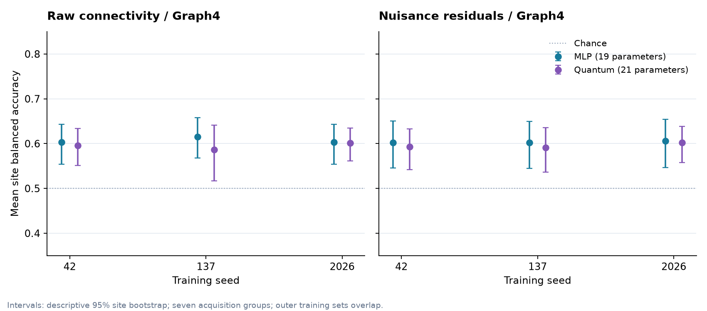
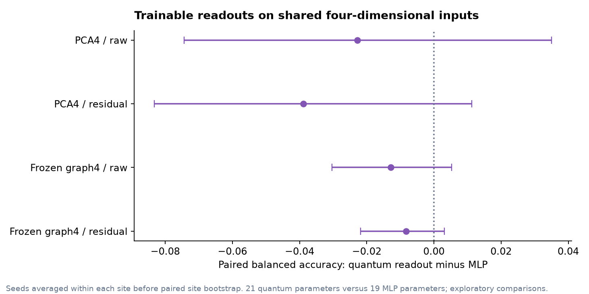

# Results and current status

Updated 2026-10-22. The primary ABIDE I cohort and nested cross-site benchmark are frozen. All planned classical, nuisance-control, PCA-kernel, trainable-readout, seed-sensitivity, label-permutation, bounded graph-kernel, and frozen graph/readout experiments are complete. The independent audit passed for 16 experiment series, 145 model settings, and 62,640 held-out predictions, plus the permutation artifacts. The sanitized aggregate and figures are exported below. An uncapped graph-kernel run was interrupted after one polynomial SVM fit remained active for more than nine hours; the complete rerun uses a fixed polynomial solver cap.

## Main finding

The clearest signal so far is a four-coordinate fidelity quantum kernel on fold-fitted PCA representations of raw connectivity, using the full training fraction in each fold. It reached 64.6% mean site balanced accuracy across three PCA seeds (64.52%, 64.63%, 64.63%). The matched logistic model averaged 59.6% (59.67%, 59.58%, 59.67%) and the matched RBF SVM 58.9% (58.79%, 59.10%, 58.79%). The average paired difference was 4.95 percentage points against logistic, with a descriptive seven-site bootstrap interval from approximately 0.00 to 10.34 points, and 5.70 points against RBF SVM (1.26 to 10.67 points).

This is a promising exploratory result, not evidence of a general quantum advantage. It is specific to one representation and dimension, follows broader exploratory comparisons, spans only seven acquisition groups, and has uncertain site-level precision. The signal is weaker after nuisance residualization and disappears with fewer training participants. The full-edge classical logistic reference remains higher at 69.1% balanced accuracy.

## Cohort and evaluation

The primary cohort contains 432 participants: 205 with autism and 227 controls, distributed across seven acquisition groups. It uses the frozen ABIDE I PCP C-PAC filtered, no-global-signal-regression, CC200 derivative policy. Screening requires complete demographic and motion fields, all five manual quality ratings marked OK, mean framewise displacement below 0.2, at least 100 timepoints, and minimum group sizes. Two constant-signal NYU control scans were excluded after metadata screening.

All models use nested leave-one-acquisition-group-out evaluation with three grouped inner folds. Reported headline scores are unweighted means across the seven held-out groups. Intervals resample those seven groups and are descriptive: the training sets overlap, and a seven-group bootstrap is coarse. Follow-up configurations were exploratory and were not adjusted for the number of comparisons.

The original classical predictions were independently reproduced by the verified offline rerun. Across all 1,296 predictions, model summaries and fold metrics matched; the verified prediction file is byte-identical to the original. The result auditor independently recomputes metrics from saved predictions and checks participant identities, group assignments, folds, source archives, configuration receipts, and paired representation fingerprints.

## Completed model comparisons

| Experiment | Mean site balanced accuracy | Mean site AUROC | Reading |
| --- | ---: | ---: | --- |
| Full-edge logistic reference | 69.1% | 0.781 | Strongest completed classical reference |
| Full-edge RBF SVM | 69.0% | 0.780 | Similar to logistic |
| Age, sex, and motion logistic control | 56.3% | 0.625 | Demographics and motion alone carry signal |
| Nuisance-residualized edges, logistic | 64.5% | 0.713 | Lower than raw-edge reference |
| Raw PCA4 quantum kernel, three-seed mean | 64.6% | 0.703 | Most promising matched quantum-kernel result |
| Raw PCA4 logistic, three-seed mean | 59.6% | 0.660 | Matched linear comparison |
| Raw PCA4 RBF SVM, three-seed mean | 58.9% | 0.624 | Matched nonlinear comparison |
| Residual PCA4 quantum kernel, three-seed mean | 60.5% | 0.649 | Close to matched logistic at 60.2% / 0.641 |
| Raw graph4 quantum kernel | 60.7% | 0.623 | Near logistic at 60.4% / 0.651; below polynomial SVM at 62.1% / 0.652 |
| Residual graph4 quantum kernel | 59.7% | 0.575 | Near logistic at 59.7% / 0.656; no clear paired difference |
| Raw PCA4 trainable quantum readout, three-seed mean | 56.5% | 0.572 | Below the matched 19-parameter MLP at 58.8% / 0.647 |
| Residual PCA4 trainable quantum readout, three-seed mean | 56.1% | 0.598 | Below the matched MLP at 60.0% / 0.635 |
| Raw graph4 quantum trainable readout, three-seed mean | 59.4% | 0.639 | Below matched MLP at 60.7% / 0.652; paired difference -1.28 points (site-bootstrap interval -3.04 to +0.52) |
| Residual graph4 quantum trainable readout, three-seed mean | 59.5% | 0.612 | Below matched MLP at 60.4% / 0.656; paired difference -0.82 points (-2.18 to +0.31) |

The raw PCA4 quantum-kernel result did not carry to six or eight coordinates: those settings scored 59.6% and 57.6%. On the raw PCA4 representation, averaging the three seeds gave 56.4% at half the training data and 53.9% at one quarter; the matched logistic models scored 58.5% and 56.4%. The small-data comparison therefore does not support a stable quantum-kernel edge.

The trainable quantum readout used a four-qubit variational circuit with 21 trainable parameters. Its classical MLP comparator used 19 parameters, the same frozen PCA inputs, identical folds, and the same training schedule. The quantum model did not consistently match the MLP. This weakens the case for the trainable circuit in this setup.

The completed signed-graph run produces little evidence of a quantum-kernel advantage on the learned graph embeddings. Raw graph quantum minus logistic balanced accuracy averaged 0.33 percentage points (descriptive seven-site interval: -0.66 to 1.65); quantum minus polynomial SVM averaged -1.38 points (-6.26 to 2.21). Residual graph quantum was close to logistic on balanced accuracy but lower on AUROC. None of the capped polynomial fits reported convergence warnings. The solver cap followed a nine-hour stall in the first graph run; the retained partial run is separate from the complete rerun.

The follow-up froze each fold-trained graph encoder and compared a 21-parameter quantum readout with a 19-parameter MLP over three seeds. The quantum readout averaged 59.4% balanced accuracy on raw embeddings and 59.5% after residualization, compared with 60.7% and 60.4% for the MLP. Both descriptive paired seven-site intervals include zero. This result does not support an advantage for the quantum readout in this setup.

## Confounding and label check

The primary cohort has higher mean motion in the autism group than in controls, and the sex distribution differs between groups. Adding age, sex, and motion covariates, or residualizing connectivity against them inside each training fold, lowers performance from the raw-edge reference. This shows that nuisance handling matters. It does not identify a causal source for the score change: residualization can also remove variation associated with diagnosis.

In 99 within-acquisition-group label permutations, the full nested logistic workflow had a null mean of 49.8% balanced accuracy. The observed 69.1% reference exceeded all 99 null statistics, giving the plus-one empirical one-sided value 0.01, the smallest value resolvable with this number of permutations. This checks whether the reference exceeds this label-shuffle null; it does not remove motion, sex, or acquisition confounding. The saved null predictions are not independently refit by the artifact auditor; it verifies the frozen permutation targets, recorded source and receipts, observed predictions, and null-statistic arithmetic.

## External cohort status

An anonymous, metadata-only ABIDE II inventory found 1,007 candidate rows in 16 readable collection tables (474 autism, 533 controls). Candidate status means that basic metadata and identity filters passed; it does not mean scan-quality eligibility. The available tables do not include the current motion and five manual QC fields required by the primary cohort policy, so no ABIDE II modeling cohort or external score is available.

The candidate inventory reproduced byte-for-byte offline with matching collection summaries. No imaging data were downloaded. Some listed collection tables remain unavailable, so the current zero numeric-ID overlap is limited to the inspected snapshot; 281 external rows have GUIDs, but the development ABIDE I snapshot has no GUID crosswalk. This inventory does not establish independence from every ABIDE I release participant.

## Figures and artifacts

The [sanitized aggregate](results/aggregate.json) contains fold-level metrics and diagnostics without participant-level records. It is linked to the final audit report by SHA-256. The independent audit report is retained under the ignored `results/audit-final-v2/` directory.

Additional controls, permutation, seed, and training-fraction figures are in [docs/figures](figures/).

## Limits and next research step

The current work establishes a reproducible benchmark on one screened cohort, not clinical utility, biomarker validity, or quantum-computing advantage. The limited number and imbalance of acquisition groups constrain both estimates and intervals. Only 432 of the 1,035 metadata-available participants remained after scan availability and strict QC (41.7%); this may select a nonrepresentative cohort. The PCA quantum-kernel finding should be checked in a prospectively specified independent dataset with compatible quality fields, or in a new confirmatory cohort, before stronger claims are made.

The next research decision should focus on confirmation rather than adding more same-cohort model variants. If the raw PCA4 kernel remains the main signal, the follow-up should freeze that representation and kernel in advance, define a primary metric and a meaningful effect threshold, and evaluate it on an independent cohort with a matching QC policy. Increasing qubit count or searching more feature maps on the same seven groups would not resolve the current validation limit.

Reproduction commands and environment pins are in [reproduction.md](reproduction.md). Protocols and seed choices are documented in the linked experiment notes there; the verified cohort and original classical findings remain described in the [data card](data-card.md) and [classical results](classical-results.md).
